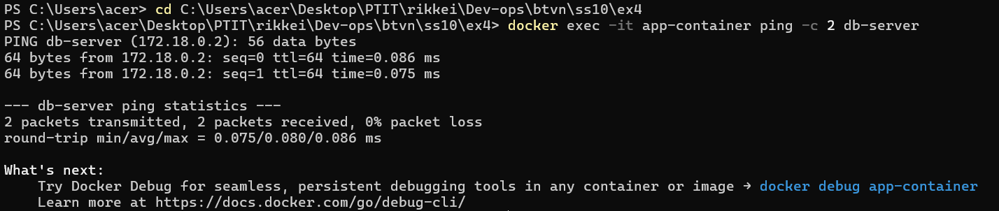
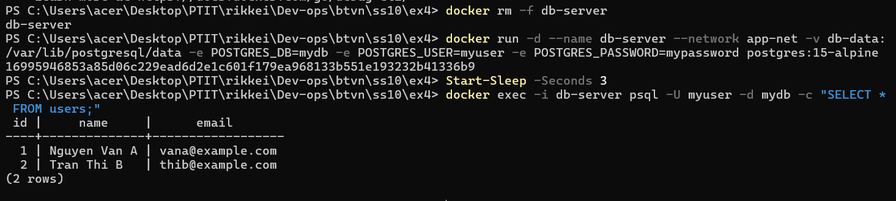

# Thư mục lưu trữ ảnh chụp màn hình kết quả thực thi (Chỉ 2 ảnh theo yêu cầu đề bài):
# 1.        - Lệnh ping db-server từ Backend container giải mã thành công IP nội bộ của DB container.
# 2.       - Dữ liệu DB nguyên vẹn sau khi tái tạo container DB mới.
